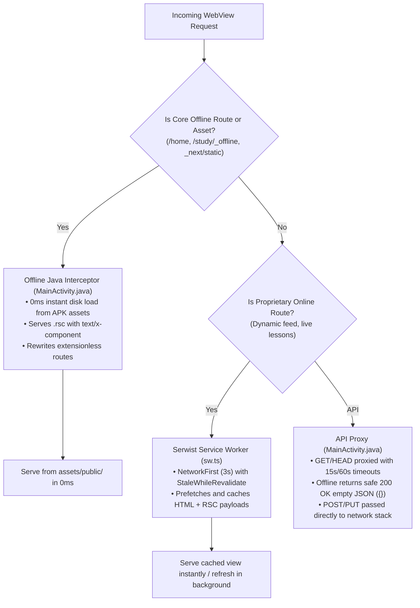
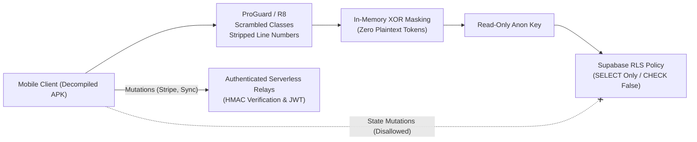

# PNPM & Next.js Android Hybrid Architecture (Median.co Edition)

[](https://nextjs.org/)
[](https://capacitorjs.com/)
[](https://pnpm.io/)
[](https://tailwindcss.com/)
[](https://developer.android.com/)
[](https://serwist.pages.dev/)
[](https://median.co/)

A battle-tested production blueprint, native plugin bridge, and build automation pipeline for crafting standalone, offline-first hybrid Android applications. Built with **Next.js 15 App Router, Capacitor 8, PNPM, Tailwind CSS, Serwist, and Median.co specifications**.

---

## 🚀 Overview: The Problem with Traditional Hybrid Apps

Most web-to-mobile architectures fall into one of two fatal traps:

```
❌ The Webapp Wrapper Trap:
   Capacitor server.url or loadUrl() points to an external web host (e.g. Render/Vercel).
   Result: The app breaks completely without internet, navigations lag, and Same-Origin
   Policy is violated—locking the WebView out of on-device IndexedDB (Dexie) and local file storage.

❌ The Rigid Static Export Trap:
   Full next export strips server dynamic features, and client-side navigations fetch
   React Server Component (*.rsc) streams that the WebView intercepts as 404s or misinterprets
   as HTML, triggering React Error #418 (Hydration Mismatch) and hard reload loops.
```

### The Solution: Dual-Engine Hybrid Architecture

This architecture combines an **Offline Java Interceptor** with a **Serwist Service Worker** to deliver 0ms offline boot times while preserving seamless caching for proprietary online software.



---

## 💎 Median.co UI/UX Specifications & Ergonomics

Transform a standard WebView into a buttery-smooth, native-feeling Android application:

### 1. Dynamic Safe Area Insets (Notches & Gesture Bars)
Never use fixed pixel padding. Use dynamic CSS `env()` safe-area insets with hardware fallbacks:
* **Top App Bar / Status Bar Clearance**:
  ```css
  pt-[max(calc(env(safe-area-inset-top,0px)+10px),14px)]
  /* For hero cards & menus: */
  pt-[max(calc(env(safe-area-inset-top,0px)+16px),24px)]
  ```
  Prevents camera punch-holes and status bar icons from occluding tabs or headers.
* **Bottom Footer / Navigation Bar Clearance**:
  ```css
  pb-[max(calc(env(safe-area-inset-bottom,0px)+14px),18px)]
  /* For floating buttons & action drawers: */
  pb-[max(calc(env(safe-area-inset-bottom,0px)+16px),24px)]
  ```
  Ensures bottom action bars and input textareas are never clipped by Android's gesture line or 3-button navigation bar.

### 2. App-Like Zero Scrollbar Visibility
Native mobile apps do not show desktop scrollbars during touch scroll:
```css
/* Tailwind CSS utility: no-scrollbar */
@layer utilities {
  .no-scrollbar::-webkit-scrollbar {
    display: none;
  }
  .no-scrollbar {
    -ms-overflow-style: none;
    scrollbar-width: none;
  }
}
```
In `MainActivity.java`:
```java
webView.setHorizontalScrollBarEnabled(false);
webView.setVerticalScrollBarEnabled(false);
webView.setOverScrollMode(View.OVER_SCROLL_IF_CONTENT_SCROLLS);
```

### 3. Touch Scroll Ergonomics
* **Avoid `overflow-hidden` on Root**: Putting `overflow-hidden` on the main app shell freezes touch scrolling on physical Android devices.
* **Use `overflow-x-clip`**: Prevents horizontal wobble while enabling butter-smooth, hardware-accelerated vertical inertia scrolling.

### 4. Declarative `appConfig.json` Engine
Median.co-inspired centralized asset configuration for orientation locking, theme colors, and plugin registry:
```json
{
  "general": {
    "appName": "StudyUp",
    "screenOrientation": { "androidPhone": "portrait", "androidTablet": "portrait" },
    "keepScreenOn": false
  },
  "styling": {
    "androidStatusBarStyle": "dark",
    "androidStatusBarBackgroundColor": "#0F0F12",
    "androidSystemNavBarColor": "#0F0F12"
  },
  "navigation": {
    "androidPullToRefresh": true,
    "swipeGestures": true
  },
  "services": {
    "firebaseMessaging": { "active": true },
    "oneSignalV5": { "active": true, "applicationId": "YOUR-ONESIGNAL-APP-ID" },
    "haptics": { "active": true },
    "barcode": { "active": true },
    "socialLogin": { "googleSignIn": { "active": true } },
    "appReview": { "active": true },
    "share": { "active": true }
  }
}
```

---

## 🔌 Native Plugins Ecosystem

Connect your React UI directly to native Android device APIs with zero third-party framework friction:

| Plugin | Capability | Implementation Pattern |
| :--- | :--- | :--- |
| **OneSignal & FCM** | Push notifications & custom deep links | `@capacitor/push-notifications` with custom scheme intent handling in `MainActivity.java` |
| **Tactile Haptics** | Physical keypress & answer feedback | `@capacitor/haptics` (`Light`, `Medium`, `Heavy`, `NotificationType.Success`) |
| **Biometric Auth** | Fingerprint & Face Unlock for sensitive data | `capacitor-native-biometric` with graceful hardware fallback |
| **QR / Barcode** | Fast camera scanning for deck sharing | `@capacitor-mlkit/barcode-scanning` |
| **Document Share** | "Open with StudyUp" system receiver | `ACTION_VIEW` & `ACTION_SEND` intent filters in `AndroidManifest.xml` with staging queue |
| **In-App Review** | Native Google Play rating prompts | `app-review` bridge invoking `ReviewManager.requestReviewFlow()` |
| **Native Share** | System sheet sharing for links & cards | `@capacitor/share` delegating to Android `Intent.ACTION_SEND` |

---

## 🛡️ Tamper-Proof Client Security (Receiver-Only Architecture)

Modeled after enterprise banking and Meta/Facebook client security patterns:



1. **Receiver-Only Principle**: The mobile client is strictly a data **consumer/receiver**. It cannot alter schemas, update server environments, or drop database tables.
2. **Supabase Row-Level Security (RLS)**: Client-side `anon` key is strictly restricted to `SELECT` on public tables. Direct client `INSERT`, `UPDATE`, and `DELETE` queries are rejected (`WITH CHECK (false)`).
3. **Bytecode XOR Token Masking (`ObfuscatedConfig.java`)**: API URLs and credentials are stored as XOR-masked byte arrays in Java/TypeScript and decoded only in memory at runtime—preventing plaintext string extraction via `strings`, `grep`, or Ghidra decompilation.
4. **ProGuard / R8 Rules (`proguard-rules.pro`)**: Classes, methods, and field signatures are shrunk and scrambled, and production logging (`Log.d`, `Log.v`) is completely stripped.

---

## ⚡ In-Module Synthetic UI Audio (`soundcn` / Web Audio API)

Do not package loose `.mp3` or `.wav` files into assets (they create HTTP round-trip latency, risk 404s, and add bloat). Synthesize tactile audio feedback with the Web Audio API:

```ts
// Gentle physical brushing sound for card flips and drawer toggles
playBrush() {
  const ctx = this.getContext();
  if (!ctx) return;
  const dur = 0.16;
  const buf = ctx.createBuffer(1, ctx.sampleRate * dur, ctx.sampleRate);
  const data = buf.getChannelData(0);
  for (let i = 0; i < data.length; i++) {
    const t = i / data.length;
    data[i] = (Math.random() * 2 - 1) * Math.sin(t * Math.PI);
  }
  const noise = ctx.createBufferSource();
  noise.buffer = buf;
  const filter = ctx.createBiquadFilter();
  filter.type = 'bandpass';
  filter.frequency.setValueAtTime(680, ctx.currentTime);
  filter.frequency.linearRampToValueAtTime(1180, ctx.currentTime + 0.08);
  filter.frequency.linearRampToValueAtTime(460, ctx.currentTime + dur);
  filter.Q.value = 1.15;
  const gain = ctx.createGain();
  gain.gain.setValueAtTime(0.5, ctx.currentTime);
  noise.connect(filter).connect(gain).connect(ctx.destination);
  noise.start();
}
```

---

## 📑 Master Catalog of 22 Field-Tested Pitfalls & Solutions

| ID | Issue / Symptom | Root Cause | Permanent Architectural Solution |
| :--- | :--- | :--- | :--- |
| **BUG-01** | Mangled HTML / Missing CSS in WebView | `sync-android-assets.js` copied stale `public/index.html` over `.next/server/app/index.html`. | Skip `index.html` when copying `public/`; sync freshly compiled `.next/server/app/index.html`. |
| **BUG-02** | 10MB Feed Payload Timeout & JSON error | 6s read timeout aborted large deck downloads and returned a 404 HTML string. | Increase timeouts to 15s connect / 60s read in `MainActivity.java`; parse text first before JSON. |
| **BUG-03** | Leaderboard 10th Place / Duplicate Accounts | Multi-DB assigned different UUIDs for same email; fallback entry created 0 XP duplicate. | Canonical identity matching with Strict Max Metric Deduplication (`Math.max(...)`). |
| **BUG-04** | Flashcard Controls Disabled on Card Front | `useFlashcardSession.ts` had an unnecessary `!isFlipped` guard returning early. | Remove `!isFlipped` guard so cards can be evaluated from front or back. |
| **BUG-05** | Enumeration Check Answers Flash | `shuffledItems` used `useCallback(...)()` which created a new array reference every render. | Change `shuffledItems` to `useMemo(...)`; guard reset effect with `prevTopicRef`. |
| **BUG-06** | Notes Tab Infinite Loading Spinner | Dynamic route parameter `deckId` was unresolved or undefined in offline WebView. | Add `effectiveDeckId` fallback using pathname regex and `localStorage`. |
| **BUG-07** | Gallery Empty Despite Cards Having Images | Cards had not synced embedded base64 images into the Dexie `images` table. | Add self-healing check in `ImagesClient.tsx` to inspect `cards` and call `bulkCreateImages()`. |
| **BUG-08** | AI Chat HTTP 404 in Native App | `fetch('/api/lab/chat')` requested a relative path on `http://localhost` where no server runs. | Wrap API calls in `apiUrl(...)`, resolving to cloud server on native Android. |
| **BUG-09** | Standalone APK Secret Leaks | Default Android asset packaging does not exclude `.env` files. | Add AAPT `ignoreAssetsPattern` with `.env*` exclusions and run post-sync purge sweep. |
| **BUG-10** | Stripe Pro Purchase Cloud Flow | Hardcoded payment links expire or leak secrets. | Open cloud server checkout in Capacitor Browser; verify via Supabase webhooks + RLS. |
| **BUG-11** | AAPT `<dir>_*` Stripping (`_next` purged) | Default AAPT pattern includes `<dir>_*`, purging all folders starting with `_`. | Remove `<dir>_*` from `ignoreAssetsPattern` in `android/app/build.gradle`. |
| **BUG-12** | React Error #418 (RSC Navigation Failure) | WebView interceptor converted `.rsc` requests to `.html`, breaking App Router hydration. | Intercept `.rsc` in `MainActivity.java` and return MIME `text/x-component`. |
| **BUG-13** | Viewport Touch Scroll Lock | Putting `overflow-hidden` on main container froze all vertical touch scrolling. | Replace with `overflow-x-clip` on root layout to allow smooth vertical scrolling. |
| **BUG-14** | The Recursive APK Bloat Trap | Placing compiled APK inside `public/` caused Gradle to package previous APK inside new APK. | Keep APKs strictly in native build outputs (`build/outputs/apk/`); never put in `public/`. |
| **BUG-15** | Stale Chunk Accumulation Trap | Asset sync script was not purging `_next/static/`, leaving obsolete chunk hashes cached. | Purge target `_next/static/` folder before copying fresh Webpack bundles. |
| **BUG-16** | WebApp Wrapper Hijack Trap | `server.url` or `webView.loadUrl(remoteUrl)` loaded remote web server instead of local assets. | Remove `server.url`; ensure WebView loads `getBridge().getAppUrl()` (`https://localhost`). |
| **BUG-17** | Same-Origin IndexedDB Breakdown | Navigating WebView to remote domain swapped origin, hiding local `https://localhost` IndexedDB. | Permanently lock WebView origin to `https://localhost`; communicate only via API bridges. |
| **BUG-18** | Untracked Android Source Trap | Putting `android/` in `.gitignore` or as a broken submodule hid native fixes from git. | Track all Android Java, XML, and Gradle configs; only ignore `.gradle/` and `build/`. |
| **BUG-19** | Stale APK Served by Download Endpoint | Download route checked candidate list without inspecting file timestamps (`mtimeMs`). | Update `findLatestApk()` to dynamically sort and serve newest timestamped binary. |
| **BUG-20** | Bottom Navigation Off-Center Drift | Underline glider was placed outside grid container, causing 4px margin drift. | Place glider inside `<div className="grid grid-cols-5 relative">` for 100% mathematical alignment. |
| **BUG-21** | KaTeX Crash on Nested `\text{\frac{...}}` | AI generated invalid nested LaTeX formulas that KaTeX's parser could not parse. | Add AST unwrap pre-processor in `KaTeXMath.tsx` converting to `\frac{\text{...}}{\text{...}}`. |
| **BUG-22** | Shared File Redirect to Public Feed | Unrecognized `content://` intent URI caused fallback `loadUrl('/feed')`, wiping staged files. | Guard `handleNotificationIntent` to ignore `content://` schemes; stage files in Zustand store. |

---

## 🛠️ One-Click Build & ADB Deployment Automation

Build, package, assemble, and stream the APK to your physical Android device in one command:

```bat
@echo off
REM Execute: build_hybrid_median.bat
.\build_hybrid_median.bat
```

### Manual CLI Pipeline
```bash
# 1. Install dependencies with PNPM
pnpm install

# 2. Build Next.js Webpack production bundle with Serwist
pnpm run build

# 3. Synchronize assets to Android container with AAPT safeguards
node scripts/sync-android-assets.js

# 4. Assemble Android Debug APK
cd android
.\gradlew.bat assembleDebug
cd ..

# 5. Stream APK directly to physical Android phone over ADB
adb push android/app/build/outputs/apk/debug/app-debug.apk /data/local/tmp/app.apk
adb shell pm install -r /data/local/tmp/app.apk
adb shell am force-stop com.studyup.app
adb shell am start -n com.studyup.app/.MainActivity
```

---

## 📂 Project Structure

```
├── android/
│   ├── app/
│   │   ├── build.gradle              # AAPT exclusions, packaging options, R8 config
│   │   ├── proguard-rules.pro        # ProGuard bytecode obfuscation & class scrambling
│   │   └── src/main/
│   │       ├── AndroidManifest.xml   # Intent filters (ACTION_VIEW, ACTION_SEND, deep links)
│   │       ├── assets/
│   │       │   ├── appConfig.json    # Median.co runtime configuration
│   │       │   └── public/           # Bundled Next.js app shells, .rsc, and _next bundles
│   │       └── java/com/studyup/app/
│   │           ├── MainActivity.java # Offline Java Interceptor (shouldInterceptRequest)
│   │           └── security/         # In-memory XOR bytecode token masking
├── scripts/
│   ├── sync-android-assets.js        # Asset synchronizer & AAPT <dir>_* guardian
│   └── upload-apk.js                 # Single canonical artifact uploader to Supabase
├── src/
│   ├── app/                          # Next.js App Router static pages
│   ├── lib/
│   │   ├── apiBase.ts                # Dynamic API resolver (cloud on native, relative on web)
│   │   └── soundcn.ts                # Web Audio API in-module synthetic sound effects
│   └── sw.ts                         # Serwist Service Worker online caching & RSC prefetching
├── build_hybrid_median.bat           # One-click Windows build and ADB deployment script
├── capacitor.config.ts               # Standalone Capacitor configuration (androidScheme: 'https')
└── package.json                      # PNPM scripts and dependencies
```

---

## 🔍 Diagnostics: Terminal Logcat, Chrome Console & Toolchain

Triangulate bugs using the **Triple-Lens Protocol** (Native Logcat → Chrome Remote Inspect → StylePeek / PPTX2HTML):

### 1. Terminal Logcat Playbook (`adb logcat`)
Monitor real-time native device logs to catch 404s, missing RSC streams, and timeouts:
```bash
# Monitor package activity and Chromium WebView output
adb logcat -v time | Select-String "com.studyup.app|Capacitor|Chromium|GoNative|Median"
```
* **Asset 404 (`net::ERR_FILE_NOT_FOUND`)**: Indicates an unmapped extensionless route or missing index pair (`public/[route]/index.html`).
* **React Error #418 (Hydration Mismatch)**: Indicates an `.rsc` request received HTML instead of a React Server Component stream (`text/x-component`).
* **Missing CSS Bundles**: Indicates Gradle/AAPT stripped `_next/` because of `<dir>_*`. Ensure `<dir>_*` is excluded from AAPT ignore rules.
* **SocketTimeoutException**: Indicates deck downloads with large base64 images exceeded HTTP read timeouts (increase to 15s connect / 60s read).

### 2. Chrome Remote Debugging & WebView Console (`chrome://inspect`)
Inspect the live Android WebView on your physical device from desktop Chrome:
1. Navigate to `chrome://inspect/#devices` on your desktop browser.
2. Locate the connected device and click **Inspect** on `StudyUp (https://localhost)`.
3. **Console Tab**: Debug uncaught JavaScript errors, Promise rejections, and Dexie IndexedDB upgrades.
4. **Network Tab**: Verify that requests resolve to local `https://localhost` disk assets rather than leaking to external servers.
5. **Application Tab**: Inspect local IndexedDB (`StitchDB` tables: `decks`, `cards`, `images`) and localStorage session tokens.

### 3. Integrated Toolchain: StylePeek & PPTX2HTML
* **StylePeek Studio (Extension ID `hpjgbeajpcpdacgmhaeblneeglbggaej`)**:
  - Unpacked extension located at `C:\Users\yuze2\Desktop\StylePeek-by-Rence-master`.
  - Automatically transforms into a **Mobile Console Taskbar** at the bottom on viewports $\le 768\text{px}$ with safe-area insets.
  - Universal Element, Icon & SVG Sizing Engine: touch-enabled 4-corner stretch handles, XML attribute sync, `viewBox` protection, and quick-adjust scale chips (`0.5x`, `1x`, `1.5x`, `2x`).
* **PPTX2HTML**:
  - Cloned from `g21589/PPTX2HTML`.
  - Pure JavaScript slide converter with zero runtime dependencies.
  - Converts `.pptx` slides directly into standalone HTML/SVG components, enabling instant extraction of curriculum lecture diagrams and vector shapes into React without manual Figma tracing.

---

## 📜 License
MIT License. Free to use, adapt, and build standalone hybrid Android applications with zero vendor lock-in.
