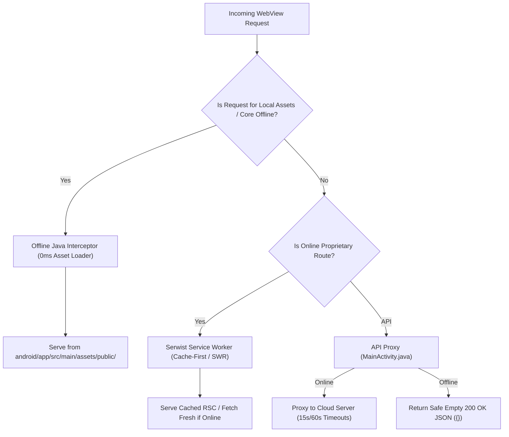

# PNPM & Next.js Android Hybrid App Architecture Guide (Median.co Edition)

Use this skill whenever you are building, modifying, bundling, or debugging standalone hybrid Android applications built with **Next.js (App Router), Capacitor, PNPM, Tailwind CSS, and Median.co specifications**.

This guide encapsulates battle-tested blueprints from production codebases, native Android bridges, Serwist service worker caching, Median.co layout ergonomics, tamper-proof client obfuscation, and a comprehensive catalog of 22 hybrid app pitfalls and solutions.

---

## 1. Core Architectural Invariants

### A. The "Standalone Native First" Invariant (Never Load Remote URLs on Boot)
* **No Remote Web Wrapper**: Never set `server.url` in `capacitor.config.ts` or command `webView.loadUrl(remoteServerUrl)` inside `MainActivity.java` `onCreate()`.
* **Preserve Same-Origin (`https://localhost`)**: Pointing the WebView to an external domain breaks browser Same-Origin Policy, locking the app out of on-device IndexedDB (`Dexie`) and local app storage (`context.getFilesDir()`).
* **Authoritative Local Assets**: All core app shells (`.next/server/app`), compiled static chunks (`_next/static/`), fonts, and media must be packaged directly inside `android/app/src/main/assets/public/`.

### B. The Receiver-Only Client Invariant (Facebook / Banking Security Pattern)
* **Receiver-Only Principle**: The mobile client is strictly a **consumer/receiver** of data. It must never have administrative, schema-mutating, or server-configuration permissions.
* **Least-Privilege API Keys**: Client-side keys (e.g. `NEXT_PUBLIC_SUPABASE_ANON_KEY`) are restricted strictly to `SELECT` operations governed by Row Level Security (RLS).
* **Mutations via Protected Relays**: All sensitive write operations (payments, account upgrades, AI batch processing) must be delegated to authenticated backend relays/webhooks with HMAC request signing and user session validation.
* **Zero Secret Leakage**: Service role keys, private API secrets, and raw `.env` files must NEVER be packaged into the APK.

---

## 2. Dual-Engine Hybrid Routing Strategy

Instead of choosing between a purely offline static bundle or a fragile online wrapper, use a **Dual-Engine Architecture**:



### A. Offline Java Interceptor (`MainActivity.java`)
Next.js App Router uses React Server Components (RSC) and client-side transitions. Inside an Android WebView:
1. **RSC Interception**: Requests with header `RSC: 1` or query `?_rsc=` are intercepted and served as `.rsc` files with MIME type `text/x-component` directly from APK assets.
2. **Dynamic Route Rewriting**: Dynamic player routes like `/study/[deckId]/notes` are mapped to pre-rendered offline templates (`public/study/_offline/notes.html`).
3. **Extensionless Route Rewriting**: Routes like `/feed`, `/leaderboard`, `/download` are mapped to `/public/[route].html` and passed to Capacitor's JS injector.
4. **API Proxy & Safe Offline Fallback**:
   - `GET`/`HEAD` to `/api/*`: Proxied to live cloud server with 15s connect / 60s read timeouts. If offline or connection fails, returns safe `200 OK` empty JSON (`{}`) so UI never throws unhandled network errors.
   - `POST`/`PUT`/`DELETE`: Bypassed (`return null`) to let Chromium network stack send full payloads.

```java
// MainActivity.java - Custom BridgeWebViewClient snippet
@Override
public WebResourceResponse shouldInterceptRequest(WebView view, WebResourceRequest request) {
    Uri uri = request.getUrl();
    String host = uri.getHost();
    if (host == null || (!"localhost".equalsIgnoreCase(host) && !"127.0.0.1".equalsIgnoreCase(host))) {
        return null;
    }

    String path = uri.getPath();
    if (path == null) path = "/";

    // 1. Static chunks & media
    if (path.startsWith("/_next/") || path.startsWith("/assets/") || path.endsWith(".js")
            || path.endsWith(".css") || path.endsWith(".png") || path.endsWith(".svg")) {
        return null;
    }

    // 2. Next.js RSC requests
    Map<String, String> headers = request.getRequestHeaders();
    boolean isRsc = (headers != null && "1".equals(headers.get("RSC"))) || uri.getQueryParameter("_rsc") != null;
    if (isRsc) {
        String rscAsset = resolveRscAsset(path);
        if (rscAsset != null) {
            try {
                InputStream is = getAssets().open(rscAsset);
                return new WebResourceResponse("text/x-component", "UTF-8", 200, "OK", null, is);
            } catch (IOException ignored) {}
        }
    }

    // 3. Dynamic offline routes
    if (path.startsWith("/study/")) {
        String sub = path.substring("/study/".length());
        int slash = sub.indexOf('/');
        if (slash >= 0) {
            String mode = sub.substring(slash + 1).replace("/", "");
            return defaultClient.shouldInterceptRequest(view, rewriteRequest(request, "/public/study/_offline/" + mode + ".html"));
        }
    }

    // 4. Page routes
    String cleanPath = path.startsWith("/") ? path.substring(1).replaceAll("/$", "") : path;
    if (!cleanPath.isEmpty() && !cleanPath.contains(".")) {
        return defaultClient.shouldInterceptRequest(view, rewriteRequest(request, "/" + cleanPath + ".html"));
    }

    // 5. API Proxy & Safe Fallback
    if (path.startsWith("/api/")) {
        if ("GET".equalsIgnoreCase(request.getMethod()) || "HEAD".equalsIgnoreCase(request.getMethod())) {
            return proxyApiRequest(request);
        }
        return null;
    }

    return null;
}
```

### B. Serwist Service Worker for Proprietary Online Features (`src/sw.ts`)
For proprietary modules hosted online that need offline availability:
- Uses `NetworkFirst` (3s timeout) or `StaleWhileRevalidate`.
- Listens for `CACHE_URLS` messages from client components to prefetch and cache both document HTML and matching RSC payloads (`headers: { 'RSC': '1' }`).

---

## 3. Median.co Specifications: Ergonomics & UI Standards

Median.co (GoNative) apps feel like pure native applications because of strict adherence to viewport insets, zero-scrollbar styling, and declarative configuration.

### A. Safe Area Allowances (Notches, Punch Holes & Gesture Bars)
Never hardcode fixed pixel paddings. Use dynamic CSS `env()` safe areas with high-density device fallbacks:

* **Top Header / App Bar Allowance**:
  ```css
  /* Tailwind CSS class */
  pt-[max(calc(env(safe-area-inset-top,0px)+10px),14px)]
  /* For cards / hero menus: */
  pt-[max(calc(env(safe-area-inset-top,0px)+16px),24px)]
  ```
  Prevents status bar icons, battery indicators, and camera punch-holes from colliding with header text, tabs, or close buttons.

* **Bottom Footer / Navigation Bar Allowance**:
  ```css
  /* Tailwind CSS class */
  pb-[max(calc(env(safe-area-inset-bottom,0px)+14px),18px)]
  /* For floating action buttons / bottom sheets: */
  pb-[max(calc(env(safe-area-inset-bottom,0px)+16px),24px)]
  ```
  Ensures bottom tab bars, drawer input textareas, and CTA buttons are never occluded by Android's gesture pill line or 3-button navigation bar.

* **Native Window Insets in Android Activity**:
  ```java
  ViewCompat.setOnApplyWindowInsetsListener(findViewById(android.R.id.content), (v, insets) -> {
      Insets bars = insets.getInsets(WindowInsetsCompat.Type.systemBars());
      v.setPadding(bars.left, 0, bars.right, 0); // Allow web content to handle top/bottom via CSS env()
      return insets;
  });
  ```

### B. App-Like Zero Scrollbar Visibility
Native Android apps do not display desktop-style scrollbars when scrolling.

* **Global Tailwind Utility (`globals.css`)**:
  ```css
  @layer utilities {
    .no-scrollbar::-webkit-scrollbar {
      display: none;
    }
    .no-scrollbar {
      -ms-overflow-style: none;
      scrollbar-width: none;
    }
  }
  ```
* **WebView Native Configuration**:
  ```java
  webView.setHorizontalScrollBarEnabled(false);
  webView.setVerticalScrollBarEnabled(false);
  webView.setScrollBarStyle(View.SCROLLBARS_INSIDE_OVERLAY);
  webView.setOverScrollMode(View.OVER_SCROLL_IF_CONTENT_SCROLLS);
  ```
* **Viewport Scrolling Rule**:
  - Never put `overflow-hidden` on the main app shell container; it freezes touch dragging on mobile devices.
  - Use `overflow-x-clip` on root layouts to prevent horizontal wobble while keeping vertical inertia scrolling buttery smooth.

### C. Declarative `appConfig.json` Specification
Median.co uses a central `appConfig.json` in assets for zero-recompile runtime tuning:
```json
{
  "general": {
    "appName": "StudyUp",
    "screenOrientation": { "androidPhone": "portrait", "androidTablet": "portrait" },
    "keepScreenOn": false
  },
  "styling": {
    "androidStatusBarStyle": "dark",
    "androidStatusBarBackgroundColor": "#0F0F12",
    "androidSystemNavBarColor": "#0F0F12",
    "hideWebviewAlpha": 0.0
  },
  "navigation": {
    "androidPullToRefresh": true,
    "androidShowOfflinePage": false,
    "swipeGestures": true
  },
  "services": {
    "firebaseMessaging": { "active": true },
    "oneSignalV5": { "active": true, "applicationId": "YOUR-ONESIGNAL-APP-ID" },
    "haptics": { "active": true },
    "barcode": { "active": true },
    "socialLogin": { "googleSignIn": { "active": true } },
    "appReview": { "active": true },
    "share": { "active": true }
  }
}
```

---

## 4. Native Plugins Ecosystem & JavaScript Bridges

Connect web features to native Android capabilities using clean, resilient bridges:

### 1. OneSignal & Firebase Cloud Messaging (FCM)
* **FCM Push Tokens & Deep Links**: Listen for notification clicks and route the WebView via custom scheme:
  ```ts
  import { PushNotifications } from '@capacitor/push-notifications';
  
  export async function initPushNotifications() {
    let perm = await PushNotifications.checkPermissions();
    if (perm.receive === 'prompt') perm = await PushNotifications.requestPermissions();
    if (perm.receive === 'granted') {
      await PushNotifications.register();
      PushNotifications.addListener('pushNotificationActionPerformed', (notification) => {
        const url = notification.notification.data?.url;
        if (url) window.location.assign(url);
      });
    }
  }
  ```

### 2. Tactile Haptics
* Provide physical feedback on button clicks, card flips, and answer checks:
  ```ts
  import { Haptics, ImpactStyle, NotificationType } from '@capacitor/haptics';
  
  export const triggerHaptic = {
    light: () => Haptics.impact({ style: ImpactStyle.Light }).catch(() => {}),
    medium: () => Haptics.impact({ style: ImpactStyle.Medium }).catch(() => {}),
    heavy: () => Haptics.impact({ style: ImpactStyle.Heavy }).catch(() => {}),
    success: () => Haptics.notification({ type: NotificationType.Success }).catch(() => {}),
    warning: () => Haptics.notification({ type: NotificationType.Warning }).catch(() => {}),
  };
  ```

### 3. Biometric Authentication (Fingerprint & Face Unlock)
* Secure private decks and credentials before accessing local IndexedDB:
  ```ts
  import { NativeBiometric } from 'capacitor-native-biometric';
  
  export async function verifyUserBiometrics(): Promise<boolean> {
    const available = await NativeBiometric.isAvailable().catch(() => ({ isAvailable: false }));
    if (!available.isAvailable) return true; // Graceful fallback
    try {
      await NativeBiometric.verifyIdentity({
        reason: 'Authenticate to access private study materials',
        title: 'Biometric Login',
      });
      return true;
    } catch {
      return false;
    }
  }
  ```

### 4. QR & Barcode Scanner
* Rapid deck sharing and peer syncing via camera:
  ```ts
  import { BarcodeScanner } from '@capacitor-mlkit/barcode-scanning';
  
  export async function scanDeckQR(): Promise<string | null> {
    const status = await BarcodeScanner.requestPermissions();
    if (status.camera !== 'granted') return null;
    const { barcodes } = await BarcodeScanner.scan();
    return barcodes.length > 0 ? barcodes[0].rawValue : null;
  }
  ```

### 5. Universal Document Intent Sharing ("Open with StudyUp")
* Intercept `ACTION_VIEW` and `ACTION_SEND` in `AndroidManifest.xml` for PDF, DOCX, PPTX, TXT, MD, CSV, JSON:
  - Do **not** auto-process incoming shared files. Stage them into the Upload modal staging queue (`useUIStore.pendingSharedFiles`) so the user can inspect, rename, or add files.

---

## 5. Tamper-Proof Client Obfuscation (Receiver-Only Pattern)

Even if a malicious actor decompiles the APK with JADX, Apktool, or Ghidra, your environment credentials and backend architecture remain safe.

### A. XOR Bytecode Token Masking in Java
Never store raw API keys or project URLs as plain strings in `strings.xml`, `BuildConfig`, or JS files.
```java
package com.studyup.app.security;

public class ObfuscatedConfig {
    // Obfuscated with XOR key 0x5A
    private static final byte[] MASKED_ENDPOINT = new byte[] {
        0x32, 0x2E, 0x2E, 0x2A, 0x29, 0x60, 0x75, 0x75, 0x2D, 0x33, 0x33, 0x74, 0x29, 0x2E, 0x2F, 0x3E, 0x23, 0x2B, 0x74, 0x39, 0x3B, 0x35
    };
    private static final byte XOR_KEY = 0x5A;

    public static String getApiEndpoint() {
        byte[] decoded = new byte[MASKED_ENDPOINT.length];
        for (int i = 0; i < MASKED_ENDPOINT.length; i++) {
            decoded[i] = (byte) (MASKED_ENDPOINT[i] ^ XOR_KEY);
        }
        return new String(decoded);
    }
}
```

### B. ProGuard & R8 Obfuscation Rules (`proguard-rules.pro`)
Ensure all class names, methods, and field signatures are shrunk and scrambled:
```proguard
# Strip all line numbers and debug source file names
-renamesourcefileattribute SourceFile
-keepattributes SourceFile,LineNumberTable

# Obfuscate internal application classes
-keep class com.studyup.app.MainActivity { *; }
-keep class com.studyup.app.security.** { *; }

# Strip logging calls in production
-assumenosideeffects class android.util.Log {
    public static boolean isLoggable(java.lang.String, int);
    public static int v(...);
    public static int d(...);
}

# Preserve Capacitor Plugin Bridges
-keep public class * extends com.getcapacitor.Plugin {
    public <methods>;
}
```

### C. Row Level Security (RLS) Database Lockdown
The client-side `anon` key must have **zero write access** to critical database tables:
```sql
-- Example Supabase RLS Policy: Strict Read-Only Anon Role
ALTER TABLE public.decks ENABLE ROW LEVEL SECURITY;

CREATE POLICY "Public Read Only" ON public.decks
    FOR SELECT TO anon
    USING (is_public = true);

-- Deny all client mutations (inserts, updates, deletes must go through server edge functions)
CREATE POLICY "No Client Direct Insert" ON public.decks
    FOR INSERT TO anon
    WITH CHECK (false);
```

---

## 6. AAPT & Asset Packaging Invariants

Prevent compilation failures and asset stripping:

### `android/app/build.gradle`:
```groovy
android {
    ...
    aaptOptions {
        // CRITICAL: NEVER include <dir>_* because it strips _next/ (compiled CSS and JS) from APK!
        ignoreAssetsPattern '!.svn:!.git:!.ds_store:!*.scc:.*:!CVS:!thumbs.db:!picasa.ini:!*~:.env*:.env'
    }
    packagingOptions {
        resources {
            excludes += ['**/.env*', '**/*.env', '**/META-INF/.env*']
        }
    }
}
```

### Stale Chunk Clean Sweep (`sync-android-assets.js`):
Always purge `android/app/src/main/assets/public/_next/static` before copying new build output to prevent obsolete chunk hashes from persisting and shadowing updated code.

---

## 7. Hierarchical Android Native Back Navigation

Tapping Android's physical or gesture Back button must follow an intuitive 4-tier hierarchy:
```ts
import { App } from '@capacitor/app';

let lastBackPress = 0;

export function setupHierarchicalBackButton(handlers: {
  isModalOpen: () => boolean;
  closeModal: () => void;
  isStudyPlayer: () => boolean;
  navigateToDeck: () => void;
  isSubView: () => boolean;
  navigateToHome: () => void;
  showExitToast: () => void;
}) {
  App.addListener('backButton', () => {
    // Level 1: Close active modal, drawer, or lightbox
    if (handlers.isModalOpen()) {
      handlers.closeModal();
      return;
    }
    // Level 2: Exit study player subpage back to Deck Menu
    if (handlers.isStudyPlayer()) {
      handlers.navigateToDeck();
      return;
    }
    // Level 3: Navigate from Sub-tabs to My Library / Home
    if (handlers.isSubView()) {
      handlers.navigateToHome();
      return;
    }
    // Level 4: Double-tap on Home to exit app
    const now = Date.now();
    if (now - lastBackPress < 2000) {
      App.exitApp();
    } else {
      lastBackPress = now;
      handlers.showExitToast();
    }
  });
}
```

---

## 8. In-Module Synthetic UI Audio (`soundcn` / Web Audio API)

Do not package loose `.mp3` or `.wav` files into assets (they create HTTP round-trip latency, risk 404s, and add bloat). Synthesize tactile audio feedback with the Web Audio API:

```ts
class SoundEngine {
  private ctx: AudioContext | null = null;

  private getContext() {
    if (!this.ctx && typeof window !== 'undefined') {
      const AudioCtx = window.AudioContext || (window as unknown as { webkitAudioContext: typeof AudioContext }).webkitAudioContext;
      this.ctx = new AudioCtx();
    }
    return this.ctx;
  }

  // Gentle physical brushing sound for card flips and drawer toggles
  playBrush() {
    const ctx = this.getContext();
    if (!ctx) return;
    const dur = 0.16;
    const buf = ctx.createBuffer(1, ctx.sampleRate * dur, ctx.sampleRate);
    const data = buf.getChannelData(0);
    for (let i = 0; i < data.length; i++) {
      const t = i / data.length;
      data[i] = (Math.random() * 2 - 1) * Math.sin(t * Math.PI);
    }
    const noise = ctx.createBufferSource();
    noise.buffer = buf;
    const filter = ctx.createBiquadFilter();
    filter.type = 'bandpass';
    filter.frequency.setValueAtTime(680, ctx.currentTime);
    filter.frequency.linearRampToValueAtTime(1180, ctx.currentTime + 0.08);
    filter.frequency.linearRampToValueAtTime(460, ctx.currentTime + dur);
    filter.Q.value = 1.15;
    const gain = ctx.createGain();
    gain.gain.setValueAtTime(0.5, ctx.currentTime);
    noise.connect(filter).connect(gain).connect(ctx.destination);
    noise.start();
  }
}
export const soundEngine = new SoundEngine();
```

---

## 9. Master Catalog of 22 Real-World Pitfalls & Exact Solutions

| ID | Symptom | Root Cause | Solution |
| :--- | :--- | :--- | :--- |
| **BUG-01** | Mangled HTML / Missing CSS in WebView | `sync-android-assets.js` copied stale `public/index.html` over `.next/server/app/index.html`. | Skip `index.html` when copying `public/`; sync freshly compiled `.next/server/app/index.html`. |
| **BUG-02** | 10MB Feed Payload Timeout & JSON error | 6s read timeout aborted large deck downloads and returned a 404 HTML string. | Increase timeouts to 15s connect / 60s read in `MainActivity.java`; parse text first before JSON. |
| **BUG-03** | Leaderboard 10th Place / Duplicate Accounts | Multi-DB assigned different UUIDs for same email; fallback entry created 0 XP duplicate. | Canonical identity matching with Strict Max Metric Deduplication (`Math.max(...)`). |
| **BUG-04** | Flashcard Controls Disabled on Card Front | `useFlashcardSession.ts` had an unnecessary `!isFlipped` guard returning early. | Remove `!isFlipped` guard so cards can be evaluated from front or back. |
| **BUG-05** | Enumeration Check Answers Flash | `shuffledItems` used `useCallback(...)()` which created a new array reference every render. | Change `shuffledItems` to `useMemo(...)`; guard reset effect with `prevTopicRef`. |
| **BUG-06** | Notes Tab Infinite Loading Spinner | Dynamic route parameter `deckId` was unresolved or undefined in offline WebView. | Add `effectiveDeckId` fallback using pathname regex and `localStorage`. |
| **BUG-07** | Gallery Empty Despite Cards Having Images | Cards had not synced embedded base64 images into the Dexie `images` table. | Add self-healing check in `ImagesClient.tsx` to inspect `cards` and call `bulkCreateImages()`. |
| **BUG-08** | AI Chat HTTP 404 in Native App | `fetch('/api/lab/chat')` requested a relative path on `http://localhost` where no server runs. | Wrap API calls in `apiUrl(...)`, resolving to cloud server on native Android. |
| **BUG-09** | Standalone APK Secret Leaks | Default Android asset packaging does not exclude `.env` files. | Add AAPT `ignoreAssetsPattern` with `.env*` exclusions and run post-sync purge sweep. |
| **BUG-10** | Stripe Pro Purchase Cloud Flow | Hardcoded payment links expire or leak secrets. | Open cloud server checkout in Capacitor Browser; verify via Supabase webhooks + RLS. |
| **BUG-11** | AAPT `<dir>_*` Stripping (`_next` purged) | Default AAPT pattern includes `<dir>_*`, purging all folders starting with `_`. | Remove `<dir>_*` from `ignoreAssetsPattern` in `android/app/build.gradle`. |
| **BUG-12** | React Error #418 (RSC Navigation Failure) | WebView interceptor converted `.rsc` requests to `.html`, breaking App Router hydration. | Intercept `.rsc` in `MainActivity.java` and return MIME `text/x-component`. |
| **BUG-13** | Viewport Touch Scroll Lock | Putting `overflow-hidden` on main container froze all vertical touch scrolling. | Replace with `overflow-x-clip` on root layout to allow smooth vertical scrolling. |
| **BUG-14** | The Recursive APK Bloat Trap | Placing compiled APK inside `public/` caused Gradle to package previous APK inside new APK. | Keep APKs strictly in native build outputs (`build/outputs/apk/`); never put in `public/`. |
| **BUG-15** | Stale Chunk Accumulation Trap | Asset sync script was not purging `_next/static/`, leaving obsolete chunk hashes cached. | Purge target `_next/static/` folder before copying fresh Webpack bundles. |
| **BUG-16** | WebApp Wrapper Hijack Trap | `server.url` or `webView.loadUrl(remoteUrl)` loaded remote web server instead of local assets. | Remove `server.url`; ensure WebView loads `getBridge().getAppUrl()` (`https://localhost`). |
| **BUG-17** | Same-Origin IndexedDB Breakdown | Navigating WebView to remote domain swapped origin, hiding local `https://localhost` IndexedDB. | Permanently lock WebView origin to `https://localhost`; communicate only via API bridges. |
| **BUG-18** | Untracked Android Source Trap | Putting `android/` in `.gitignore` or as a broken submodule hid native fixes from git. | Track all Android Java, XML, and Gradle configs; only ignore `.gradle/` and `build/`. |
| **BUG-19** | Stale APK Served by Download Endpoint | Download route checked candidate list without inspecting file timestamps (`mtimeMs`). | Update `findLatestApk()` to dynamically sort and serve newest timestamped binary. |
| **BUG-20** | Bottom Navigation Off-Center Drift | Underline glider was placed outside grid container, causing 4px margin drift. | Place glider inside `<div className="grid grid-cols-5 relative">` for 100% mathematical alignment. |
| **BUG-21** | KaTeX Crash on Nested `\text{\frac{...}}` | AI generated invalid nested LaTeX formulas that KaTeX's parser could not parse. | Add AST unwrap pre-processor in `KaTeXMath.tsx` converting to `\frac{\text{...}}{\text{...}}`. |
| **BUG-22** | Shared File Redirect to Public Feed | Unrecognized `content://` intent URI caused fallback `loadUrl('/feed')`, wiping staged files. | Guard `handleNotificationIntent` to ignore `content://` schemes; stage files in Zustand store. |

---

## 10. One-Click Build & ADB Deployment Automation

To compile and test the standalone hybrid Android app in one step, use `build_hybrid_median.bat`:

```bat
@echo off
setlocal enabledelayedexpansion
title Building StudyUp Hybrid Android App (Median.co Specs)

echo ========================================================
echo   StudyUp Hybrid Android Build Pipeline
echo ========================================================

REM 1. Clean Stale Builds
echo [1/5] Purging stale static assets...
if exist "android\app\src\main\assets\public\_next" rd /s /q "android\app\src\main\assets\public\_next"

REM 2. Compile Web Application
echo [2/5] Compiling Next.js production bundle...
call pnpm run build
if %ERRORLEVEL% neq 0 (
    echo [ERROR] Next.js build failed.
    exit /b %ERRORLEVEL%
)

REM 3. Synchronize Android Assets
echo [3/5] Synchronizing web assets with AAPT safeguards...
node scripts/sync-android-assets.js
if %ERRORLEVEL% neq 0 (
    echo [ERROR] Asset synchronization failed.
    exit /b %ERRORLEVEL%
)

REM 4. Assemble Android Debug APK
echo [4/5] Compiling Android APK with Gradle...
cd android
call gradlew.bat assembleDebug
cd ..
if %ERRORLEVEL% neq 0 (
    echo [ERROR] Gradle compilation failed.
    exit /b %ERRORLEVEL%
)

REM 5. Fast Streaming Install to Connected ADB Device
echo [5/5] Streaming APK install to Android device...
set APK_PATH=android\app\build\outputs\apk\debug\app-debug.apk
if exist "%APK_PATH%" (
    adb push "%APK_PATH%" /data/local/tmp/app.apk
    adb shell pm install -r /data/local/tmp/app.apk
    adb shell am force-stop com.studyup.app
    adb shell am start -n com.studyup.app/.MainActivity
    echo ========================================================
    echo   BUILD & DEPLOY SUCCESSFUL!
    echo ========================================================
) else (
    echo [ERROR] Output APK not found at %APK_PATH%
    exit /b 1
)
```

---

## 11. Field Diagnostic Suite: Terminal Logcat, Chrome Remote Console, StylePeek & PPTX2HTML

When debugging an offline hybrid Android app, never guess what went wrong. Triangulate bugs using the **Triple-Lens Diagnostic Protocol**:
1. **Lens 1: Native Android Layer (`adb logcat`)** — detects asset interception 404s, unhandled native crashes, permission denials, and HTTP connection timeouts.
2. **Lens 2: DOM & Runtime Layer (`chrome://inspect`)** — inspects the live WebView console, network payload waterfall, local IndexedDB state, and unhandled JS rejections.
3. **Lens 3: Design & Asset Toolchain (`StylePeek` & `PPTX2HTML`)** — live mobile DOM inspection, icon/SVG resizing, and slide-to-component vector conversion.

---

### A. Terminal Logcat Diagnostic Playbook (`adb logcat`)

Connect your physical phone or emulator via ADB, then run targeted logcat filters:

#### 1. Stream App-Specific Logs in Real Time
```bash
# Filter strictly by your application package (e.g. com.studyup.app)
adb logcat --pid=$(adb shell pidof -s com.studyup.app)

# Windows PowerShell equivalent (monitoring app tag and Chromium output):
adb logcat -v time | Select-String "com.studyup.app|Capacitor|Chromium|GoNative|Median|SystemWebChromeClient"
```

#### 2. Key Diagnostic Signatures to Look For:
* **Asset 404 / Missing Route**:
  ```
  E/Capacitor/Console: File not found: https://localhost/feed (net::ERR_FILE_NOT_FOUND)
  ```
  *Diagnosis*: The asset synchronizer missed creating the directory index pair (`public/feed.html` or `public/feed/index.html`), or the Java interceptor didn't rewrite the extensionless route.
* **React Error #418 (Hydration Mismatch / Broken RSC Stream)**:
  ```
  E/Capacitor/Console: Minified React error #418; visit https://react.dev/errors/418
  ```
  *Diagnosis*: The client requested `?_rsc=` or `RSC: 1` and received an HTML document instead of a React Server Component flight stream (`text/x-component`). Verify `resolveRscAsset()` in `MainActivity.java`.
* **Missing CSS Bundles (AAPT Underscore Bug)**:
  ```
  W/Chromium: [WARNING:net_errors.cc] net::ERR_FILE_NOT_FOUND: https://localhost/_next/static/css/...
  ```
  *Diagnosis*: AAPT's `ignoreAssetsPattern` stripped the `_next/` directory because of `<dir>_*`. Ensure `<dir>_*` is removed from `android/app/build.gradle`.
* **API Connection Timeouts**:
  ```
  W/MainActivity: API proxy failed: java.net.SocketTimeoutException: Read timed out
  ```
  *Diagnosis*: Downloading large deck payloads with base64 images exceeded the HTTP read timeout. Ensure `connectTimeout >= 15000` and `readTimeout >= 60000`.

---

### B. Chrome Remote Debugging & WebView Console (`chrome://inspect`)

Debug the running Android WebView exactly like a desktop web application:

1. **Enable WebView Debugging in `MainActivity.java`**:
   ```java
   if (Build.VERSION.SDK_INT >= Build.VERSION_CODES.KITKAT) {
       WebView.setWebContentsDebuggingEnabled(true);
   }
   ```
2. **Connect Desktop Chrome**:
   - Open Google Chrome on your computer and navigate to: `chrome://inspect/#devices`.
   - Your connected phone and the app's target WebView (`StudyUp - https://localhost`) will appear in the target list.
   - Click **Inspect** to launch full Chrome DevTools docked to your physical device.

3. **What to Check in Remote DevTools**:
   * **Console Tab**:
     - Check for `TypeError: s.addListener(...).then is not a function` (Capacitor 8 listener handle change).
     - Check for unhandled Promise rejections and Dexie IndexedDB version upgrade errors.
   * **Network Tab**:
     - Inspect request URLs: ensure navigations hit `https://localhost` (local APK disk) rather than leaking to external servers.
     - Verify MIME types: confirm `*.rsc` payloads return `text/x-component` with status `200 OK`.
   * **Application Tab (Storage)**:
     - Expand **IndexedDB**: verify `StitchDB` or `studyup` database is populated with tables (`decks`, `cards`, `images`).
     - Expand **Local Storage**: verify cached session tokens (`studyup_cached_session`), theme preferences, and offline feed cache.

---

### C. Design & Asset Toolchain: StylePeek & PPTX2HTML

Two mission-critical tools used to inspect, tweak, and assemble native UI components:

#### 1. StylePeek Studio (Extension ID `hpjgbeajpcpdacgmhaeblneeglbggaej`)
Located at `C:\Users\yuze2\Desktop\StylePeek-by-Rence-master`:
* **Mobile Console Taskbar**:
  - Automatically docks to the bottom on mobile viewports ($\le 768\text{px}$) with safe-area insets (`padding-bottom: max(calc(env(safe-area-inset-bottom, 0px) + 8px), 14px)`).
  - Provides quick-adjust steppers (`-W`, `+W`, `-H`, `+H`) and scale multipliers (`0.5x`, `1x`, `1.5x`, `2x`) directly above the taskbar.
* **Universal Element, Icon & SVG Sizing Engine**:
  - Touch-enabled 4-corner stretch handles supporting mobile fingertip dragging.
  - Automatically updates SVG XML `width`/`height` attributes, ensures `viewBox` is preserved to prevent vector clipping, recursively scales child SVGs, and sets `font-size` with `line-height: 1` for icon glyphs.
* **Workflow**: Inspect the live app in a mobile browser viewport, tweak sizes and colors in real time with StylePeek, and copy the clean computed styles directly into your Next.js components.

#### 2. PPTX2HTML (Pure JS Slide-to-Component Converter)
Cloned from `g21589/PPTX2HTML`:
* **Zero-Runtime Dependency**: Converts PowerPoint presentations (`.pptx`) into self-contained HTML/SVG slides preserving full PresentationML timing trees, transitions, and vector shapes.
* **Component Extraction**: Extract diagrams, infographics, tables, and vector shapes directly from curriculum lecture slides into lightweight, standalone React/Tailwind components without manual Figma tracing.
```bash
# Convert lecture slides to standalone clean HTML/SVG
node bin/pptx2html.js lecture.pptx -o output.html --static
```

